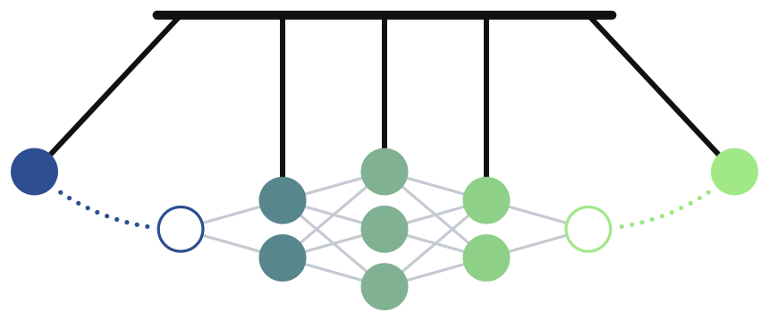
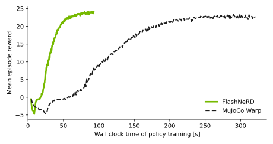

<p align="center">
  <picture>
    <source media="(prefers-color-scheme: dark)" srcset="docs/_static/newton-neural-logo-dark.svg">
    
  </picture>
</p>

# newton-neural

> [!WARNING]
> **newton-neural is in preview.** APIs may change, and checkpoints saved by one version may not load in the next.

**Learned robot dynamics for the [Newton](https://github.com/newton-physics/newton) physics engine.**

`newton-neural` lets you train neural dynamics models on data from a physics solver and run them as drop-in Newton
solvers across thousands of parallel worlds. The primary goal is accelerating reinforcement learning in Newton and
[Isaac Lab](https://github.com/isaac-sim/IsaacLab).

## Why neural dynamics?

Reinforcement learning and sampling-based control require billions of simulation steps, and contact-rich rigid-body
simulation is often the bottleneck. Accurate contact resolution demands small substeps and iterative constraint
solves across thousands of parallel environments.

Learned dynamics change that trade-off:

- **Speed.** A single forward pass advances all worlds by a full control period at fixed cost, replacing multiple
  physics substeps and contact iterations.
- **Differentiability (planned).** End-to-end differentiable rollouts enable analytical gradients with respect to
  actions and parameters for policy optimization and system identification.
- **Real-world fine-tuning (planned).** Models pretrained in simulation can be fine-tuned on real robot trajectories
  to narrow the sim-to-real gap.

This preview focuses on **speed**. Differentiable rollout and real-data fine-tuning utilities are not included yet.

## How it fits into Newton

`newton-neural` depends only on Newton and integrates natively into Newton's simulation stack:

- **Drop-in `SolverBase`.** Trained models run as Newton solvers (`SolverNeRD` and `SolverNeRDMuJoCo`), reusing
  Newton's scene representation, states, controls, kinematics, collision detection, and sensors.
- **Zero-copy on-device execution.** Joint states and controls are exposed to PyTorch directly from Newton's Warp
  arrays without host transfers (zero-copy views for replicated worlds). Contact sensing runs in Warp kernels, the
  network is compiled with `torch.compile`, and on CUDA the entire step replays from a CUDA graph.
- **Isaac Lab support.** Isaac Lab invokes `newton-neural` through Newton's solver interface (for example, the
  `physics=newton_nerd` preset in Isaac Lab).

## Models and FlashNeRD

All model families share one interface (`NeRDBase`), so recording, training losses, evaluation tools, and solvers
work uniformly across families. **FlashNeRD** is the first model family included in the library.

Contact creates sharp discontinuities in robot dynamics, and Newton already computes contact geometry cheaply and
accurately. Rather than asking a neural network to infer contact from joint state alone, **FlashNeRD** computes
contact features externally and feeds them into a temporal network that predicts the robot's response.

A `FlashNeRD` model combines a `SystemArticulation` (describing the robot) with three swappable components:

| Component | Options | When to use |
|---|---|---|
| **Contact input** | `None` *(default)* | No contact (e.g., a robot arm moving in free space). |
| | `ContactInputProbes` | Contact at known body locations against a ground plane (e.g., quadruped feet). |
| | `ContactInputSet` | Arbitrary contact geometry; reads contacts from Newton's collision pipeline. |
| **Prediction** | `PredictionStateIncrement` *(default)* | Standalone neural solver (`SolverNeRD`). |
| | `PredictionFreeMotion` | Two-way object manipulation: predicts free-space joint accelerations while MuJoCo Warp solves contact (`SolverNeRDMuJoCo`). |
| **Backbone** | `BackboneFlash` *(default)* | Short temporal history at low fixed cost (parallel attention + FFN blocks). |
| | `BackboneTransformer`, `BackboneMLP` | Standard attention baseline, or an MLP for minimal/single-frame history. |

### Performance snapshot

The chart below compares single-GPU PPO training for Isaac Lab's ANYmal C flat-terrain walking task
(`physics=newton_nerd`) using `FlashNeRD` versus MuJoCo Warp (reward evaluated on each policy's training physics):



- **Simulation step speedup:** ~30x faster than MuJoCo Warp in FP16 (`precision="fp16"`) and 7–10x faster in IEEE
  FP32.
- **End-to-end RL speedup:** 2–3x faster wall-clock PPO training, bounded by Isaac Lab's reward, reset, and
  observation overhead, with comparable GPU memory usage.
- **Transfer:** The policy trained on FlashNeRD walks and tracks velocity commands in MuJoCo Warp at matching speed,
  with a somewhat higher fall rate.

See the [performance guide](docs/guide/performance.rst) for precision modes, compilation options, and benchmarking.

## Scope and limitations

`newton-neural` is a good fit when:

- You simulate thousands of parallel instances of one robot and physics stepping is your bottleneck.
- The robot morphology, actuators, and control period (`frame_dt`) are fixed and can be recorded from a reference
  solver.
- You want to stay inside Newton or Isaac Lab with their existing scenes, tasks, sensors, and viewers.

It is **not** a general-purpose physics engine:

- A checkpoint is tied to the robot morphology, drive properties, and `frame_dt` used during recording.
- Domain-randomized masses, joint gains, or friction applied after training are not observed by the network.
- Predictions are reliable only within the state, control, and contact distributions covered by the training dataset.
- This preview supports articulated rigid robots with a fixed or floating base and revolute, prismatic, and fixed
  joints.

## Workflow

Data collection is task- and policy-agnostic: one trained model serves any policy or planner driving the robot with
the same controls and `frame_dt`.

1. **Record:** Step a reference solver across many parallel worlds from sampled states and commands, saving frames to
   disk.
2. **Train:** Fit the model on sliding frame windows using a standard PyTorch training loop.
3. **Evaluate:** Measure open-loop rollout drift on held-out worlds and run live audits against the reference solver.
4. **Deploy:** Load the checkpoint into `SolverNeRD` or `SolverNeRDMuJoCo` and step it like any Newton solver.

## Installation

`newton-neural` uses [uv](https://docs.astral.sh/uv/) and requires Linux (`x86_64` or `aarch64`), Python 3.11+,
Newton 1.9.0.dev0+ (with the `sim` extra), Warp 1.17+, PyTorch 2.11+, and NumPy 2+. A GPU is optional for tests and
small runs.

Install from source:

```bash
git clone https://github.com/newton-physics/newton-neural.git
cd newton-neural
uv sync
uv run -m newton_neural.tests
```

Add to another `uv` project:

```bash
uv add "newton-neural @ git+https://github.com/newton-physics/newton-neural.git"
```

See the [installation guide](docs/guide/installation.rst) for platform notes (including `aarch64` CUDA wheels) and
tested versions.

## Quickstart

This minimal script records, trains, and deploys a `FlashNeRD` model on Newton's cartpole. Sizes are scaled down so
it finishes in seconds on a CPU; production models typically record millions of frames and train for thousands of
steps on a GPU.

```python
import newton
import newton.examples

from newton_neural.data import SimulationNewton, TrajectoryRecorder, TrajectoryWindows
from newton_neural.models import FlashNeRD
from newton_neural.solvers import SolverNeRD
from newton_neural.systems import SystemArticulation
from newton_neural.training import LossOneStep, create_optimizer

# 1. Build a replicated Newton scene (64 cartpoles with position-controlled joints).
robot = newton.ModelBuilder()
robot.default_joint_cfg.target_ke = 100.0
robot.default_joint_cfg.target_kd = 10.0
robot.add_urdf(newton.examples.get_asset("cartpole.urdf"), floating=False, enable_self_collisions=False)
scene = newton.ModelBuilder()
scene.replicate(robot, 64)
model = scene.finalize()

# 2. Record trajectories from MuJoCo Warp (4 substeps per 0.02 s frame).
system = SystemArticulation.from_model(model)
mujoco = newton.solvers.SolverMuJoCo(model)
simulation = SimulationNewton(model, mujoco, system, frame_dt=0.02, substep_count=4)
nerd = FlashNeRD(system).to(simulation.device)  # Untrained model declares which signals to record
recorder = TrajectoryRecorder(simulation, nerd)
dataset = recorder.record("data/cartpole", frame_count=64)

# 3. Train on consecutive frame windows with a standard PyTorch loop.
windows = TrajectoryWindows(dataset, length=16, device=nerd.device)
nerd.fit_normalization(windows.loader(256))
loss, optimizer = LossOneStep(noise=0.1), create_optimizer(nerd)
for batch in windows.loader(256):
    optimizer.zero_grad()
    loss(nerd, batch).backward()
    optimizer.step()
nerd.save("cartpole.pt")

# 4. Deploy as a drop-in Newton solver (1 neural step per 0.02 s frame).
solver = SolverNeRD(model, "cartpole.pt")
state, control = model.state(), model.control()
for _ in range(50):
    solver.step(state, state, control, None, 0.02)
```

To run the full-scale version with evaluation and a side-by-side viewer against MuJoCo Warp (add `--viewer null` on
headless machines):

```bash
uv run --extra examples -m newton_neural.examples quickstart
```

## Examples

Runnable examples ship inside the package. Each records data, trains a model, and compares it side by side with
MuJoCo Warp. Pass `--extra examples` for the OpenGL viewer, or `--viewer null` to run headless without extra
dependencies.

| Command | Description |
|---|---|
| `uv run --extra examples -m newton_neural.examples quickstart` | End-to-end record, train, evaluate, and deploy workflow on a cartpole. |
| `uv run --extra examples -m newton_neural.examples contact_probes` | Quadruped on flat ground using foot contact probes (`ContactInputProbes`). |
| `uv run --extra examples -m newton_neural.examples contact_set` | Quadruped on randomized platforms using detected contacts (`ContactInputSet`). |
| `uv run --extra examples -m newton_neural.examples coupling` | Robot arm pushing a free box via two-way coupling (`SolverNeRDMuJoCo`). |

## Documentation

Build the Sphinx guide and API reference locally:

```bash
uv run --group docs sphinx-build -b html docs docs/_build/html
```

## Contributing

See [CONTRIBUTING.md](CONTRIBUTING.md). Contributions require a signed Contributor License Agreement (CLA).

## License

`newton-neural` is licensed under the [Apache License, Version 2.0](LICENSE.md). Its documentation is licensed under
[CC-BY-4.0](https://creativecommons.org/licenses/by/4.0/).
